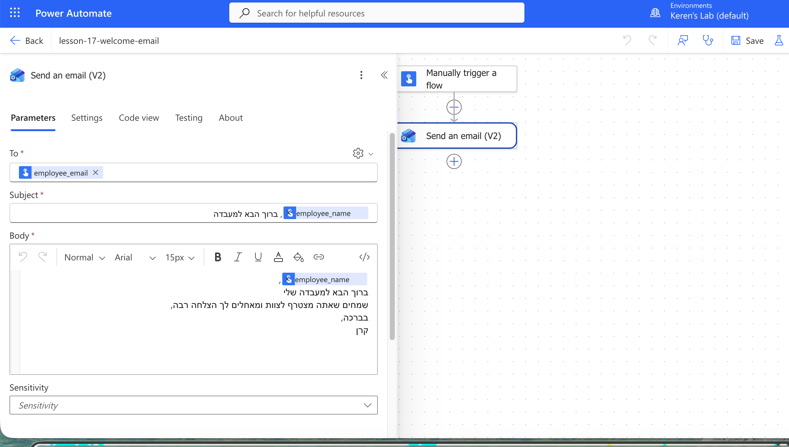
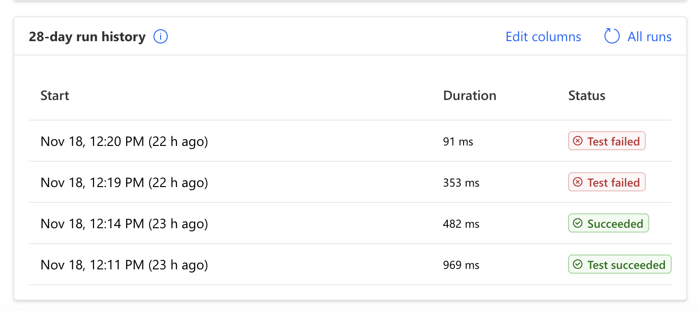

# שיעור 17 · Power Automate: סביבה ו-flow ראשון

פרויקט D · משאבי אנוש בעולם מיקרוסופט · שיעור 1 מתוך 3

## מה נבנה

- **סביבה:** ניסיון של Microsoft 365 Business Basic, "חברה" בדויה עם משתמש מנהל. החידוש האוטומטי כובה מיד (Cancel on expiration), כדי שהניסיון יסתיים בלי חיוב.
- **flow ראשון:** Instant cloud flow שמופעל בלחיצה. מי שמריץ מזין שם עובד ומייל, וה-flow שולח מ-Outlook מייל "ברוכים הבאים" עם השם.

## מושגים: n8n מול Power Automate

| n8n | Power Automate |
| --- | --- |
| Workflow | Flow |
| Trigger | Trigger (אחד בכל flow) |
| Node | Action |
| Credential | Connection (שייך למשתמש, לא ל-flow) |
| Expression `{{ }}` | Expression (fx) |
| Executions | Run history (28 יום) |

| סוג flow | מקביל ב-n8n |
| --- | --- |
| Automated | טריגר של אירוע באפליקציה, או Webhook |
| Instant | Manual Trigger |
| Scheduled | Schedule Trigger |

## איך נבדק

| ריצה | קלט | צפוי | בפועל |
| --- | --- | --- | --- |
| 1 | שם בדוי + כתובת אמיתית | מייל מגיע, Succeeded | ✓ |
| 2 | שדה מסוג Email, טקסט חופשי | — | ✓ הטופס חסם, הריצה לא התחילה |
| 3 | כתובת בדויה עם @ | — | Succeeded, המייל חזר כ-Undeliverable |
| 4 | שדה מסוג Text, טקסט חופשי | Failed עם שגיאה ברורה | ✓ `String/email` בצעד המייל |

## ממצאים

1. **Succeeded לא אומר שהמייל נמסר.** כתובת בדויה עם @ עברה את ה-flow בהצלחה, והמייל חזר כ-Undeliverable לתיבה השולחת. תפקיד ה-flow הוא למסור את המייל לשרת, לא לנמען. בדיקת מסירה: Message trace ב-Exchange admin center.
2. **סוג השדה בטריגר הוא שכבת בדיקת קלט.** שדה Email בטופס הריצה הוא people picker: כתובת חיצונית מתקבלת רק אחרי Enter, וטקסט חופשי נחסם. שדה Text מעביר הכל, והשגיאה מגיעה רק בצעד המייל.
3. **שם השדה נכתב בתיבה השמאלית.** התיבה הימנית היא התיאור שמי שמריץ את ה-flow רואה. בטעות הראשונה, השמות הגיעו לתיאור, והגלולות נשארו "Text" ו-"Email".
4. **שדה Sensitivity הוא תווית סיווג, לא טקסט.** טקסט חופשי שהוזן בו בטעות היה גורם לכישלון בריצה.
5. **ביטול מנוי ≠ כיבוי חידוש.** Cancel subscription מכבה ניסיון כמעט מיד. מה שצריך הוא Recurring billing = Off, או Cancel on expiration.

## בארגון אמיתי

- **רישוי:** HTTP, SQL ו-Dataverse הם Connectors מסוג Premium, ולא כלולים ב-Business Basic. קריאה למודל מתוך flow דורשת רישיון Premium, או קרדיטים של AI Builder (Run a prompt). זו החלטת תקציב, לא החלטה טכנית.
- **בעלות:** flow נשען על ה-Connections של היוצר. כשהעובד עוזב, החיבורים נשברים גם אם יש ל-flow Co-owner. הפתרון: חשבון שירות ייעודי שמחזיק את החיבורים, ו-Co-owner כגיבוי.
- **שולח:** מייל לעובד חדש נשלח מתיבה משותפת (hr@) עם הרשאת Send As, ולא מתיבה אישית.
- **פרטיות:** שמות וכתובות של עובדים הם מידע אישי. בצילומי המסך כאן אין כתובות אמיתיות.

## קבצים

- [flow-welcome-email.png](flow-welcome-email.png): ה-flow.
- [run-history.png](run-history.png): היסטוריית הריצות.

